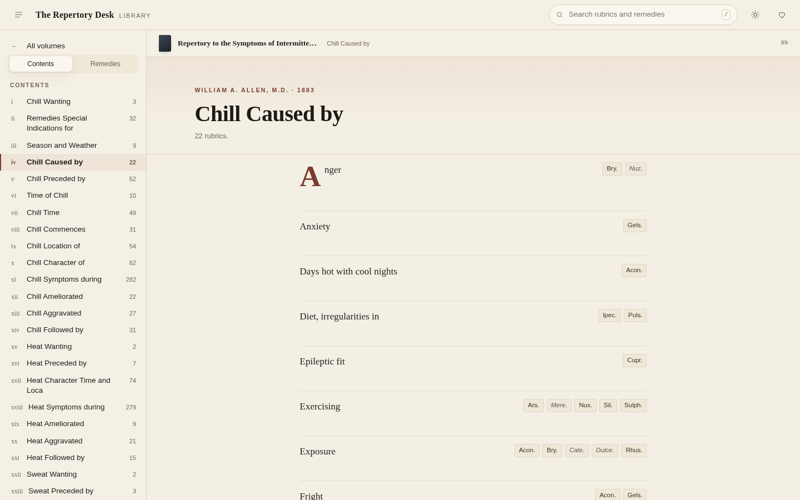

# The Repertory Desk

[](docs/play/index.html)
[](docs/play/index.html)
[](docs/play/index.html)
[](LICENSE)

**A quiet reading room for seventeen classical homoeopathic repertories and five
public-domain treatises** — 271,421 rubrics, 744,394 graded remedy links and 703
sections of prose, read straight from the open JSON library on GitHub. No account,
no server, no tracking, no build step.

**Live:** <https://drsamonline.github.io/repertory-reader/> &nbsp;·&nbsp;
**The reader:** <https://drsamonline.github.io/repertory-reader/play/> &nbsp;·&nbsp;
**The library:** <https://github.com/drsamonline/homoeopathic-materia-medica-repertory-json>



## The treatises

The library also carries prose works as a **treatise**: no rubrics, no remedies. A
numbered treatise (the Organon) shows a § against each paragraph; a chaptered one shows
its chapter title instead. Each is a separate volume and none is merged with another —

- **Organon, sixth edition**, Boericke 1922 — 291 paragraphs
- **Organon, fifth edition**, Dudgeon 1849 — 294 paragraphs
- **Allen, The Chronic Miasms — Psora and Pseudo-Psora**, 1908 — 25 chapters
- **Allen, The Chronic Miasms — Sycosis**, 1908 — 23 chapters
- **Bradford, The Life and Letters of Dr. Samuel Hahnemann**, 1894 — 70 chapters

They are different books: 74 paragraphs are worded differently and §292–§294 exist only
in the fifth. Each paragraph carries the source it was read from and the fraction of its
12-letter sequences found verbatim in OCR scans of that same edition, so you can see for
yourself that a paragraph is the book's text and not a reconstruction.

## What it is

A reader. It opens a volume on its own contents and shows each rubric the way the
book printed it — the symptom in the measure of the page, the remedies the book
sets beside it, and the printed grade marks where the source carries them. Every
remedy is a door: tap a chip to see the rubrics in that volume which list it.

It does not repertorise, score, rank, correct or complete anything. A repertory is
evidence; a reader that starts guessing stops being evidence.

| | |
|---|---|
| **Read** | A repertory opens chapter by chapter, in the printed order; a materia medica opens by remedy, with its portrait, clinical indications and symptoms grouped by chapter. Knerr's 43 chapters, Kent's 34, Gentry's A–Z; single-file volumes build their contents from the sections inside the file. |
| **Search** | Three scopes — the open chapter, the volume, then every volume already on your device. Remedy abbreviations and resolved names are searched too. |
| **Follow** | Remedy chips filter a volume to the rubrics that carry them; the rail can list a volume by its drugs instead of its chapters. |
| **Themes** | Paper, vellum, sage, slate, lampblack — remembered per device, with serif text at a measured line length. |
| **Offline** | Chapters are kept in IndexedDB and served by a service worker, so a second visit works with the connection off. HTML stays network-first, so a release is never hidden behind a stale cache. |
| **Fast** | No framework, no dependencies, no build. Rendering is windowed — a 13,000-rubric chapter paints sixty rows at a time. |

## This app is locked

`docs/play/` is hand-built and hand-maintained: no CI, no build workflow, no
bundler, and no packaging into an EXE, an APK or a Linux binary. It is not wired
into `app-builder` and no automation regenerates its markup or design. See
[LOCKED.md](LOCKED.md) — if a change cannot be made without a build step, the
change is wrong.

## Run it

```bash
git clone https://github.com/drsamonline/repertory-reader
cd repertory-reader/docs && python3 -m http.server 8000
# open http://localhost:8000/play/
```

By default the reader fetches the library from GitHub (jsDelivr, falling back to
raw.githubusercontent.com). To read a local mirror of the library instead — the
way this app was tested — put the library's files under your web root and add
`?lib=../lib/`:

```
play/?lib=../lib/
```

## The library

Every volume is public domain, transcribed from its own scan and published as
app-ready JSON with a QC report per book, plus a `catalog.json` manifest this
reader loads first. The library is versioned and rebuilt by scripts; this reader
is not.

| volume | year | rubrics |
|---|---|---|
| Knerr — Repertory to Hering's Guiding Symptoms | 1896 | 131,685 |
| Kent — Repertory of the Materia Medica | 1897 | 52,447 |
| Gentry — Concordance Repertory, vol. I | 1893 | 40,493 |
| Clarke — Clinical Repertory | 1904 | 12,537 |
| Repertory to Hering's Condensed Materia Medica | 1889 | 11,156 |
| Pulford — Rheumatism & Sciatica | 1898 | 7,518 |
| Bryant — Pocket Manual | 1851 | 4,965 |
| Sensations as if — Holcomb | 1890 | 2,721 |
| Vilas — Therapeutics of the Eye and Ear | 1883 | 2,465 |
| Allen — Intermittent Fever | 1883 | 1,708 |
| Boenninghausen — Therapeutic Pocket Book | 1891 | 1,323 |
| Humphreys — Sexual System | 1860 | 1,280 |
| Jahr — Symptomatology | 1847 | 587 |
| Lippe's Repertory | 1879 | 452 |
| Drake — Foot-sweat | 1894 | 84 |
| Jahr — Manual, Part I: Materia Medica | 1847 | 199 remedies |
| Bell — Homoeopathic Therapeutics | 1906 | 103 remedies |

## Support

| | |
|---|---|
| UPI (India) | `drsohilboi@ybl` — [open in a UPI app](upi://pay?pa=drsohilboi%40ybl&pn=Dr.%20Sohil%20Momin&cu=INR) |
| Ko-fi | <https://ko-fi.com/matneo> |
| PayPal | <https://paypal.me/drsohilmomin?locale.x=en_GB&country.x=IN> |
| Books | <https://www.amazon.com/stores/author/B08ZT331LY/allbooks?ccs_id=aed72b9f-71d9-41dc-adee-e9368a317acc> |
| All projects | <https://drsamonline.github.io/> |
| Email | <sohilmomin2000@gmail.com> |

Nothing here is behind a payment and nothing is asked for on load.

## Licence

The reader is CC0 1.0. The library carries its own licence — CC0 for the compiled
public-domain datasets, GNU GPL v3 for `repertorium-publicum-2008/`, which this
reader does not ship.
